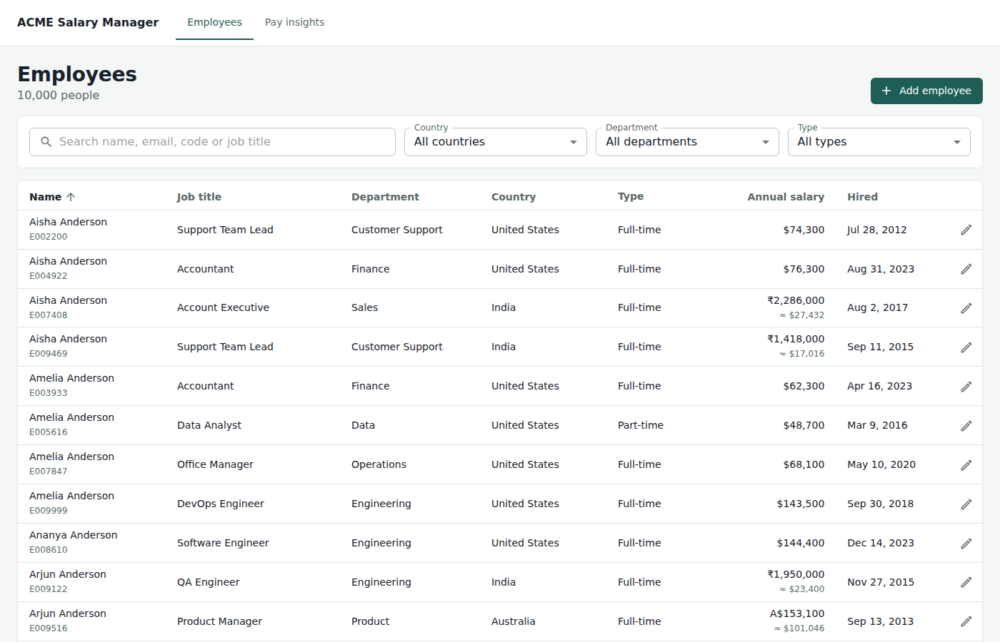
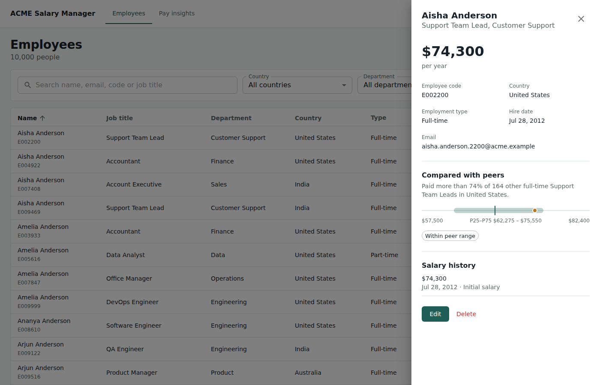
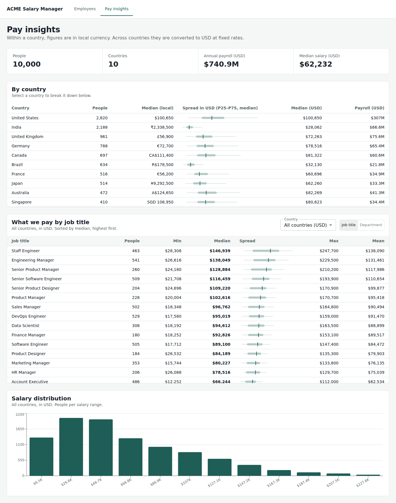

# ACME Salary Manager

A web app for ACME's HR Manager to maintain salary data for about 10,000 employees across 10 countries, and to answer questions about how the organisation pays people.



## What it does

- **Employee directory:** search (multi-word, across name, email, code and title), filter by country, department or type, sort, and paginate. The work is done server-side.
- **Add, edit and delete employees,** with validation on both client and server.
- **Salary history:** every change is recorded with the previous value, the new value, the date and a reason.
- **Multi-currency done honestly:** salaries are stored in local currency, and USD equivalents use fixed, visible reference rates.
- **Pay insights:**
  - Organisation overview and a per-country table.
  - What we pay by job title or department, for one country (local currency) or the whole organisation (USD).
  - Salary distribution.
- **Peer comparison:** where a person's pay sits against peers with the same title, country and employment type.

| Employee detail | Pay insights |
|---|---|
|  |  |

## Stack

- **Backend:** Python 3.12, FastAPI, SQLAlchemy 2, SQLite
- **Frontend:** React 18, TypeScript, Vite, MUI, TanStack Query, Recharts
- **Tests:** pytest (62 tests, 95% coverage) and Vitest (25 tests)

## Run locally

Prerequisites are Python 3.12+ and Node 20+.

```bash
make install   # backend + frontend dependencies
make seed      # 10,000 employees, about 0.5 s
make api       # http://localhost:8000  (API docs at /docs)
make web       # http://localhost:5173  (in a second terminal)
make test      # backend + frontend tests
```

To run everything in one container instead:

```bash
make docker    # http://localhost:8000, seeds itself on first boot
```

## Deploy

`render.yaml` deploys the Docker image to Render with a persistent disk for the SQLite file. Go to Render, choose **New → Blueprint**, and select this repository.

Any Docker host works the same way. Mount a volume at `/data`, expose port 8000, and use `/api/health` as the health check.

## Documentation

| Document | Purpose |
|---|---|
| [docs/requirements.md](docs/requirements.md) | One-page requirements, scope, and what was left out and why |
| [docs/plan.md](docs/plan.md) | Build order and stack choice |
| [docs/architecture.md](docs/architecture.md) | System, data model and request-flow diagrams |
| [docs/decisions.md](docs/decisions.md) | Trade-offs, one entry per decision |
| [docs/performance.md](docs/performance.md) | Measured timings, query plans, and what changes at larger scale |
| [docs/ai-usage.md](docs/ai-usage.md) | Prompts used, and where AI output was wrong and how it was caught |
| [docs/demo-script.md](docs/demo-script.md) | Script for the demo video |

## API summary

| Method | Path | Purpose |
|---|---|---|
| GET | `/api/employees` | List: `q`, `country`, `department`, `job_title`, `employment_type`, `sort`, `order`, `page`, `page_size` |
| POST | `/api/employees` | Create an employee |
| GET / PATCH / DELETE | `/api/employees/{id}` | Read, update, delete |
| GET | `/api/employees/{id}/salary-history` | Audit trail |
| GET | `/api/employees/{id}/peer-comparison` | Position against peers |
| GET | `/api/insights/overview` | Headcount, payroll, per-country stats |
| GET | `/api/insights/breakdown` | `group_by=job_title\|department`, optional `country` |
| GET | `/api/insights/distribution` | Histogram, optional `country` and `bins` |
| GET | `/api/meta` | Options for filters and form fields |

## Known gaps

These are listed in the requirements, in priority order:

1. Authentication with a `changed_by` field on salary history
2. Spreadsheet import
3. Database migrations (Alembic)
4. Termination status instead of hard delete
5. Editable exchange rates
