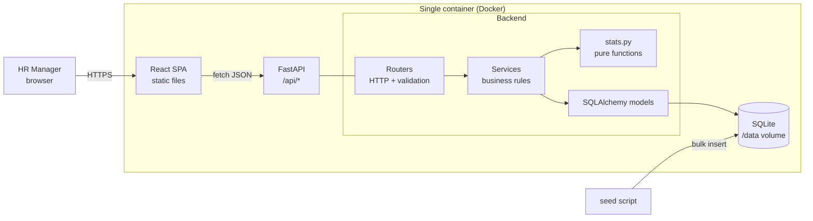
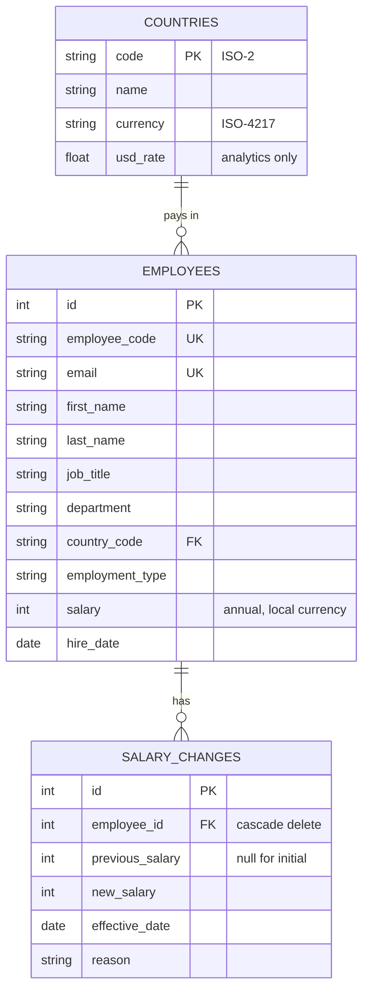
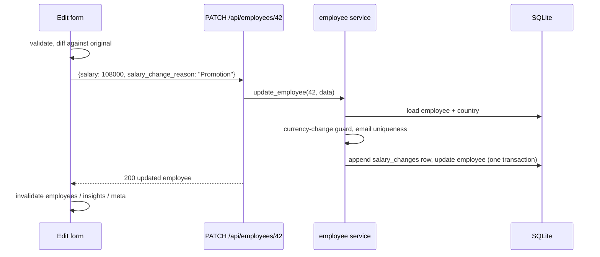

# Architecture

## Overview



One process serves both the API and the built React app. There is one deployable unit, there is no CORS in production, and it is cheap to host.

## Backend layers

| Layer | Files | Responsibility | Knows about HTTP? |
|---|---|---|---|
| Routers | `app/api/*.py` | Parse query/body, call a service, shape the response | Yes |
| Schemas | `app/schemas.py` | Shape validation (types, lengths, ranges, email) | No |
| Services | `app/services/employees.py`, `insights.py` | Business rules: uniqueness, salary history, the currency-change guard, peer selection | No |
| Stats | `app/services/stats.py` | Percentiles, summary, histogram, percentile rank | No (pure) |
| Models | `app/models.py` | Tables, constraints, indexes | No |

Services raise domain errors (`NotFoundError`, `ConflictError`, `InvalidInputError`). One handler in `app/main.py` maps them to 404/409/422, so no service imports FastAPI.

`create_app(settings, engine)` is a factory. Tests pass an in-memory engine, and the app never touches a real file at import time.

## Data model



Currency is derived from country rather than stored per employee, so the two can never disagree.

## Frontend

```
src/
  api/        client.ts (fetch + error mapping), hooks.ts (TanStack Query), types.ts
  lib/        pure, unit-tested logic: format, validation, payband maths
  components/ PayBand, EmployeeFormDialog, EmployeeDetailDrawer, ConfirmDialog
  pages/      EmployeesPage, InsightsPage (lazy-loaded)
```

- **Server state** lives in TanStack Query. Every write invalidates the employee, insights and meta queries, so the numbers on every screen stay consistent after an edit.
- **Logic lives outside components.** Validation, change-diffing and band maths are plain functions with tests, and components stay thin.
- **The edit form sends only changed fields.** A save without a salary change therefore never creates a history entry.

## Request flow: a salary change


